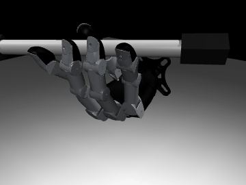

# penspin-graph

**Motion-graph planning for dexterous pen spinning on the Wuji Hand 2.**

Every frame of every pen-spinning demonstration becomes one point in a
high-dimensional state space. Frames of one episode are chained in time;
different episodes are *not* connected. We then look for places where two
episodes pass through nearly the same state, test in simulation whether the
hand can really switch from one demonstration to the other at that moment, and
keep the transitions that work. The result is a **stitched motion graph** in
which closed walks (loops) are new, executable, endless pen-spinning
behaviours assembled from pieces of different demos. From a random hand state
we find the nearest point, plan a path into a loop, and follow it; finally the
whole thing is distilled into a policy.

```
                 40 Wuji clips (25,885 frames @ 50 Hz)
                                │
        ┌───────────────────────▼────────────────────────┐
        │ 1. embed every frame -> 67-D point  (featurizer)│
        │    joints, joint velocities, pen pose/velocity, │
        │    fingertips - all in the wrist frame          │
        └───────────────────────┬────────────────────────┘
                                ▼
        ┌────────────────────────────────────────────────┐
        │ 2. motion graph: t->t+1 chains + kNN candidate  │
        │    jumps between episodes (window matching)     │
        │    + kinematic filter (joint limits, speed,     │
        │      pen continuity)                            │
        └───────────────────────┬────────────────────────┘
                                ▼
        ┌────────────────────────────────────────────────┐
        │ 3. MuJoCo validation of each jump: start at u,  │
        │    switch to v, follow v's episode with Wuji's  │
        │    released tracking policy; keep if the pen    │
        │    survives (and tracks no worse than the data) │
        └───────────────────────┬────────────────────────┘
                                ▼
        ┌────────────────────────────────────────────────┐
        │ 4. loops & planning: cycles through validated   │
        │    jumps, strongly connected "spinnable core",  │
        │    nearest-point query -> path -> reference     │
        └───────────────────────┬────────────────────────┘
                                ▼
        ┌────────────────────────────────────────────────┐
        │ 5. policy: (a) export stitched clips for        │
        │    wuji-mjlab PPO; (b) distil graph+tracker     │
        │    into a reference-free MLP (behaviour cloning)│
        └────────────────────────────────────────────────┘
```

## Results on the 40 released clips (CPU only, ~1.5 h of validation)

<p align="center"></p>

| stage | result |
|---|---|
| frames embedded | 25,885 (40 clips, 50 Hz) -> 67-D points |
| candidate jumps | 101,934 window-matched + 600 hold-to-start ("trick chaining") transitions; 5,403 removed by the kinematic filter |
| simulation validation | **40,208 jumps tested, 38,624 passed (96%)** with Wuji's released PPO tracking policy in the loop (≈60 ms per jump per core) |
| spinnable core | largest SCC = **15,215 frames (59% of the data)** can be revisited forever using only validated moves |
| loops | 151 closed walks; 16 of the top 30 complete a full lap end to end in sim |
| best loop | 16.4 s lap, 9 jumps, 3 demos stitched, 1,709° of pen-shaft rotation per lap (114°/s) |

**Compared with Wuji's original pipeline** (same scene, same tracking policy; rotation = pen-shaft rotation; see [`docs/SUMMARY.md`](docs/SUMMARY.md)):

| | original clip replay | stitched graph (ours) |
|---|---|---|
| longest continuous spinning | 21.8 s (best clip) | **84.7 s** (best loop, 5.2 laps) |
| shaft rotation in one run | 1,584° | **8,709° (24 turns)** |
| from 20 random states, 30 s: mean rotation | 555° (nearest frame, no graph) | **1,385°** (seek + circle the best loop) |
| ... still spinning after 20 s | 2 / 20 | **8 / 20** |
| ... pen drops | 10% | 15% |

Baseline sanity check: the released ONNX policy tracks the *original* clips with
~1 cm pen error in our standalone MuJoCo scene, while open-loop PD replay drops
the pen within ~0.2 s - so the scene is faithful and "validated with the policy
in the loop" is the right test.

Three things turned out to matter (details in [`docs/method.md`](docs/method.md)):
window-matched jumps alone close only tiny loops (the clips are not periodic
in the full state space); jumps inside one clip must be allowed; and the
clips' trailing *holds* are the natural place to chain tricks - a slow blend
from one clip's rest pose into the next clip's start pose connects 59% of all
frames into one strongly connected core.

Full numbers: [`runs/full3/report.md`](runs/full3/report.md); figures in `runs/full3/figures/`.

## Why this might work

* Pen spinning is **periodic**: many demos revisit similar hand/pen states, so
  cross-episode transitions exist even in a small dataset (40 clips).
* Wuji's released PPO policies are **reference-tracking** controllers: they
  follow a 50 Hz joint + pen reference and correct for imperfect references.
  They therefore (i) tell us realistically whether a stitched reference is
  executable and (ii) can execute the stitched references on the real hand
  through the existing `wuji-mjlab/deploy/pen_spin` pipeline.
* A motion graph gives **planning** for free: pick a goal frame or a loop,
  run Dijkstra, get a reference. This is the classic motion-graph /
  motion-matching recipe from character animation, applied to in-hand
  manipulation with physics validation instead of visual plausibility.

## Repository layout

```
assets/wuji_hand2/        Wuji Hand 2 (right) MJCF + meshes            (MIT, Wuji Technology)
assets/wuji_policies/     released PPO tracking policies, one per group (Apache-2.0, Wuji Technology)
data/wuji_pen_spin_clips/ the 40 motion clips (5 groups) + index.json   (Apache-2.0, Wuji Technology)
data/wuji_recipes/        Wuji's recipe files
src/penspin_graph/
  data/        clip loading, wrist-local conversion, quaternion math
  features/    FrameFeaturizer: frame -> normalised 67-D point
  graph/       MotionGraph (nodes, intra edges, kNN jumps), kinematics filter,
               loops (cycles, SCC), planner (nearest node, Dijkstra, blending,
               MotionMatchingController)
  sim/         MuJoCo scene (hand + pen, fixed wrist), PD and ONNX controllers,
               rollout, TransitionValidator
  policy/      stitched-clip export (wuji-mjlab schema), GraphTrackingPolicy,
               behaviour cloning + closed-loop evaluation
  viz/         figures
  cli.py       penspin-graph command line
tests/         pytest suite (synthetic + real data)
docs/method.md the method in detail, open questions, roadmap
```

## Install

```bash
git clone https://github.com/Zijun-Xiang/penspin-graph
cd penspin-graph
python -m venv .venv && source .venv/bin/activate     # Windows: .venv\Scripts\activate
pip install -e ".[dev]"                               # numpy, scipy, scikit-learn, mujoco, onnxruntime, torch, matplotlib, pytest
pytest                                                # ~1 min on a laptop CPU
```

Everything runs on CPU. No GPU, no mjlab, no pixi needed - except for the
optional PPO training step, which uses your existing `wuji-mjlab` setup.

## Run the pipeline

```bash
penspin-graph --run runs/demo build                         # ~3 s: embed, propose + filter jumps
penspin-graph --run runs/demo validate --workers 4 --follow-frames 50   # MuJoCo + Wuji policy
penspin-graph --run runs/demo loops --min-rotation-deg 180  # closed walks through validated jumps
penspin-graph --run runs/demo replay --loop 0 --repeats 3   # execute the best loop in sim
penspin-graph --run runs/demo eval --n-starts 20            # nearest-frame controller from random states
penspin-graph --run runs/demo export --seconds 20           # stitched clips for wuji-mjlab PPO
penspin-graph --run runs/demo train-bc --n-walks 200        # reference-free MLP policy
penspin-graph --run runs/demo viz && penspin-graph --run runs/demo report
```

`runs/full3/` holds the fully validated graph (`graph/graph.npz`, 38,624 validated
jumps - rebuild + re-validation takes ~1.5 h on 2 cores), the loops, the exported
clips recipe, the BC policy (`bc/bc_policy.onnx`) and the figures. Reproduce it with:

```bash
penspin-graph --run runs/mine build --k 12 --max-cost 6
penspin-graph --run runs/mine validate --workers 4 --follow-frames 40 --loop-closing-first --max-jumps 60000
penspin-graph --run runs/mine validate --workers 4 --follow-frames 50 --rest-only
penspin-graph --run runs/mine loops --min-rotation-deg 180 --max-frames 6000 --max-loops 300 --verify-top 30 --prune-failed --rounds 6
penspin-graph --run runs/mine eval --n-starts 20 --horizon 1500 --restrict-scc --seek-loop 0
python scripts/compare_baselines.py runs/mine            # original vs graph comparison
MUJOCO_GL=egl penspin-graph --run runs/mine render --loop 0 --format gif   # Linux headless; omit MUJOCO_GL on Windows
```

### Train PPO on the stitched references (GPU, wuji-mjlab)

`export` writes a clip group in the exact `wuji_pen_spin_clips:1` catalog
format plus a recipe. Copy them into your wuji-mjlab checkout and train as
usual:

```bash
penspin-graph --run runs/full3 export --seconds 20 --n-walks 20     # writes runs/full3/export/
cp -r runs/full3/export/clips/06_graph_stitched  $WUJI/src/wuji_mjlab/tasks/pen_spin/data/rawdata/clips/
cp    runs/full3/export/recipe/06_graph_stitched.json $WUJI/src/wuji_mjlab/tasks/pen_spin/data/recipe/
cd $WUJI && pixi run train --task WujiHand2_PenSpin \
    env.commands.motion.recipe_path=src/wuji_mjlab/tasks/pen_spin/data/recipe/06_graph_stitched.json \
    env.scene.num_envs=2048 agent.max_iterations=10000 agent.run_name=PenSpin_06_graph_stitched
```

(`num_envs=2048` fits an 8 GB GPU; see wuji-mjlab's train guide.)

## Key terms (中英对照)

| term | 中文 | meaning here |
|---|---|---|
| motion graph | 运动图 | nodes = frames, edges = recorded steps + validated jumps |
| motion matching | 动作匹配 | "find the nearest recorded frame to my current state, then follow it" |
| kNN (k-Nearest Neighbours) | k近邻 | how candidate jumps are proposed in the 67-D space |
| window matching | 窗口匹配 | compare the next *W* frames after a jump, not just one frame |
| SCC (Strongly Connected Component) | 强连通分量 | the set of frames from which spinning can continue forever |
| reference tracking policy | 参考轨迹跟踪策略 | Wuji's PPO (Proximal Policy Optimization, 近端策略优化) controller that follows a 50 Hz reference |
| BC (Behaviour Cloning) | 行为克隆 | supervised distillation of (state -> action) pairs |
| sim-to-real | 仿真到现实 | the deploy path: stitched reference + Wuji tracking policy on the physical hand |

## Data and model credits

* Motion clips, tracking policies and the hand MJCF are from
  [wuji-technology/wuji-mjlab](https://github.com/wuji-technology/wuji-mjlab)
  (release v2026.10.22, Apache-2.0) and
  [wuji-technology/wuji-description](https://github.com/wuji-technology/wuji-description) (MIT).
  See `third_party/` for the licences. This repository only redistributes the
  subset needed to reproduce the experiments.
* Method lineage: motion graphs (Kovar, Gleicher & Pighin 2002), motion
  matching (Clavet 2016), and "Lessons from Learning to Spin Pens"
  (Wang et al. 2024) for the sim trajectory -> real replay idea.

## License

Apache-2.0 for the code in `src/`, `tests/` and `docs/`. Third-party assets
keep their own licences (see `third_party/`).
