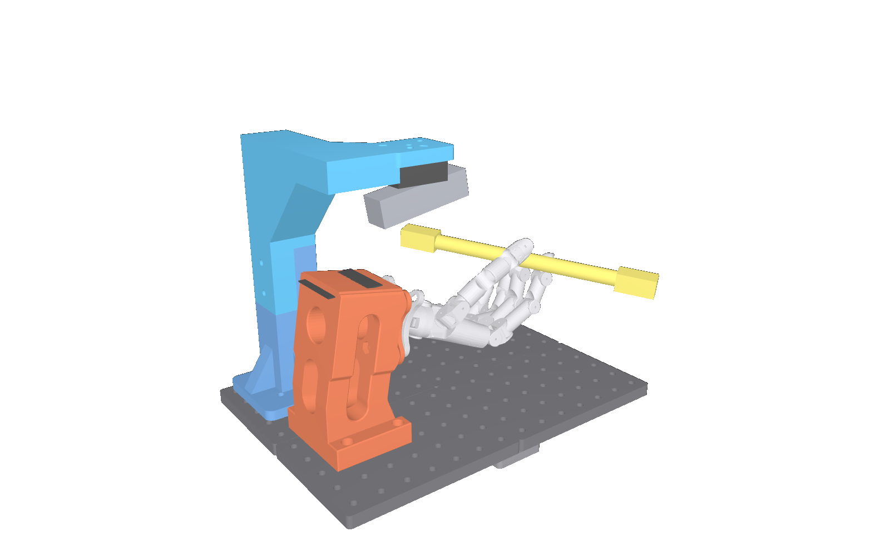
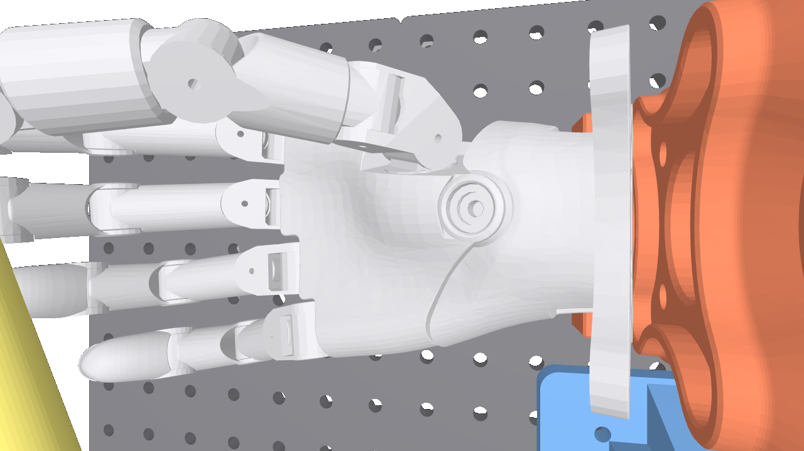
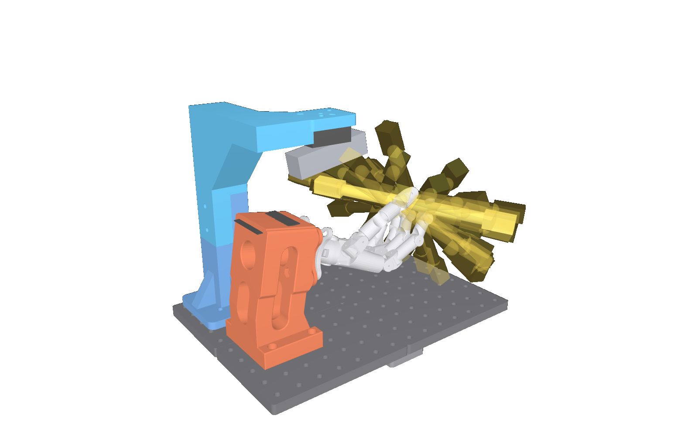

# Printable rig: breadboard, hand jig, camera column

Everything here is generated by `rig.py` (CadQuery, parametric, all dimensions in mm) and
rendered by `assembly.py`. Printable files are in `parts/` (STL for slicers, STEP for CAD),
pictures in `renders/`, and `parts/assembly.glb` is the whole rig as one 3D model
(opens in Windows "3D 查看器", Bambu Studio, Blender, or https://gltf-viewer.donmccurdy.com).



Frame: X runs along the hand (wrist → fingertips), Y across, Z up; the breadboard's top
surface is Z = 0 and its hole grid is X = 12.5 + 25 i, Y = 12.5 + 25 j.

## Parts

| Part | Qty | Size (mm) | Print orientation | ~mass |
|---|---|---|---|---|
| `breadboard_tile` | 4 | 175 × 125 × 12 | flat, nut pockets down (on the bed) | 100 g |
| `splice_plate` | 5 | 50 × 50 × 8 | flat, nut pockets down | 8 g |
| `camera_column_base` | 1 | 100 × 88 × 150 | standing on its foot | 150 g |
| `camera_column_top` | 1 | 120 × 160 × 160 | upside down: the arm's and plate's flat top face on the bed, column pointing up | 240 g |
| `wuji_hand2_base` | 1 | 150 × 90 × 82 | **print Wuji's own `base.3mf`** (`third_party/wuji_hand2_base.3mf`, Bambu profile inside); the STL here is the same part re-exported in mm | ~180 g |

The breadboard is 4 identical tiles → **350 × 250 mm**, 14 × 10 M6 holes on a 25 mm pitch
(Wuji's aluminium board is 350 × 200). Every hole has an M6 hex-nut pocket on the underside,
so anything bolts down from the top with a plain M6 bolt and a nut dropped in from below.
The tiles are joined by the five splice plates under the seams (one in the middle, two per
seam), bolted through the tile holes next to the seams.

Wuji's jig (the red part, `hardware/hand2/base.obj` from their v2026.10.22 asset bundle,
Apache-2.0) keeps its four M6 feet: they land exactly on grid holes
(37.5, 62.5), (37.5, 137.5), (87.5, 62.5), (87.5, 137.5). Its mounting face is tilted 10°,
so the hand points 10° downwards, palm up, wrist flange centre about 115 mm above the board,
fingertips near X = 300. The wrist AprilTag goes on the jig's top face (as in Wuji's photo).

## Camera column (25 cm, as requested)

A 45 × 45 mm column in two pieces with a 60 mm bolted lap joint (two M6 × 55 through both
halves), foot bolted at (37.5 / 87.5, 187.5 / 237.5): behind the hand on the +Y side, next
to the jig, where the pen never comes (the pen stays at X ≥ 102 mm during the whole loop,
the column occupies X 40–85). The foot is shortened on +Y so it stays on the 250 mm board.
An L-shaped arm (first towards −Y, then along +X) carries the camera plate
(60 × 50 × 12, top at **Z = 250**) centred at X = 130, Y = 100, above the palm.

**What 25 cm means for the camera** (`renders/pen_sweep_*.png`, `renders/clearance.json`,
from replaying `deploy/clips/graph_loop_1lap.npz` through this model):

- the pen's ends reach **Z = 248 mm** during the loop, right over the palm; the camera's
  lowest point is at **Z = 186 mm**, so the pen passes through the camera's volume on part
  of every lap. The column, arm and jig are clear (≥ 18 mm).
- from 19 cm above the board the D435i's 87° field of view covers the palm and the base of
  the fingers only (`renders/camera_view_d435i_ir.png`): the wrist AprilTag and the
  fingertips are outside the image.

So this height is fine for camera-less playback (`deploy/play_reference.py`) and for
filming, but not for closed-loop spinning with the pen observer. For that, set
`COL_TOP_Z = 330` (or the previous 360) in `rig.py` and reprint only the column top: at
330 the camera clears the pen by 2.6 cm and sees tag, hand and pen.

The plate carries your D435i bracket's hole pattern: a trapezoid with centre-to-centre
distances **37 mm** (long pair, on the +Y row), **14 mm** (short pair, on the −Y row) and
**22.4 mm** between the rows (your 40 / 17 / 25.4 mm outer-edge measurements minus one
3 mm hole). Each hole is a radial slot ±1.5 mm long for M3 screws (3.4 mm), so a 1–2 mm
measurement error still fits. The M3 nut pockets are on the plate's **top** face: the
screws come up from under the bracket, the nuts sit in the hex pockets and cannot turn,
and the bracket is clamped flat against the plate's underside. A 6.6 mm hole in the
plate centre takes a 1/4"-20 screw if you ever want a ball head instead.

**Mount the bracket under the plate** so the camera hangs below it and looks down without
the plate in the way; the bracket's hinge sets the tilt. With the camera body along X
(the hand's length) the D435i's wide 87° infrared field of view runs along the hand.





## Bolts and nuts (all M6 unless noted)

| Where | Bolt | Qty |
|---|---|---|
| splice plates (tile → splice nut) | M6 × 25 | 20 |
| Wuji jig feet (counterbore 6.8 deep in a 30 mm foot) | M6 × 40 | 4 |
| camera column foot | M6 × 30 | 4 |
| column lap joint | M6 × 55 + washers | 2 |
| D435i bracket → plate (bracket base + 12 mm plate + nut) | M3 × 20 + M3 nuts | 4 |
| M6 nuts (DIN 934, 10 mm across flats) | | ~30 |

Nut pockets are 10.4 mm across flats, 5.8 mm deep (M6) and 5.9 / 3.0 mm (M3); if your
printer prints holes tight, scale the pocket in `rig.py` (`M6_NUT_AF`) or warm the nut in.

## Printing

Material: PLA or PETG, 0.4 mm nozzle, 0.2 mm layers, **4 walls, 5 top/bottom layers,
25 % infill (gyroid or cubic)**, no supports needed for any part in the orientations above.
The column pieces benefit from 30 % infill. Print the tiles with a brim if your bed is
not perfectly flat (175 × 125 is a large footprint).

1. Open the slicer (Bambu Studio / OrcaSlicer / PrusaSlicer / Cura).
2. Import the STLs from `hardware/parts/` (File → Import). Set the orientation per the table;
   in Bambu Studio "Place on face" (快捷键 F) and click the face that should lie on the bed.
   Check the units are mm (the tile must read 175 × 125 × 12).
3. Set the profile above, slice, send to the printer. Printing time is roughly 4 h per tile,
   1 h per splice plate, 5–7 h per column piece.
4. For the red jig print `third_party/wuji_hand2_base.3mf` as it is (Wuji's own Bambu
   profile). On a non-Bambu printer import `parts/wuji_hand2_base.stl` instead and print
   it standing on its foot plate with supports enabled (the cross-shaped wrist flange
   overhangs).
5. Dry-fit an M6 nut in a tile pocket and an M6 bolt through a hole before printing the rest.

## Assembly

1. Lay the four tiles face down, drop M6 nuts into the pockets next to each seam, place
   the five splice plates (nut pockets down), bolt from the top with M6 × 25. Turn over.
2. Drop nuts into every hole you will use; bolt down Wuji's jig (M6 × 40) at the four holes
   listed above, the wrist-flange side facing +X (towards the long side of the board).
3. Bolt the column base (M6 × 30) at (37.5 / 87.5, 187.5 / 237.5), the short side of the
   foot towards the board edge; slide the column top onto the lap, two M6 × 55 with
   washers through both.
4. Drop four M3 nuts into the pockets on top of the camera plate, hold the D435i bracket
   under the plate and drive M3 × 20 screws up through the bracket into the nuts; camera
   body along X, lenses towards the fingertips; tilt about 10° at the hinge.
5. Mount the hand on the jig flange (Wuji's screws), palm up, cable behind the wrist.
   Stick the wrist AprilTag on the jig top; place the pen as in `deploy/start_pose_02_clip_003.png`.

## Regenerating

```bash
pip install cadquery trimesh pyrender
python hardware/rig.py        # parts/*.stl, *.step, parts.json
python hardware/assembly.py   # renders/*.png, parts/assembly.glb
```

Change the layout at the top of `rig.py` (`COL_CENTRE`, `COL_TOP_Z`, `PLATE_OFFSET_X`, the
bracket pattern `BRK_*`) and rerun. `assembly.py` also replays the deployed loop and writes
`renders/clearance.json` (minimum pen-to-part distances), so a layout change can be checked
against the pen's motion before printing.
